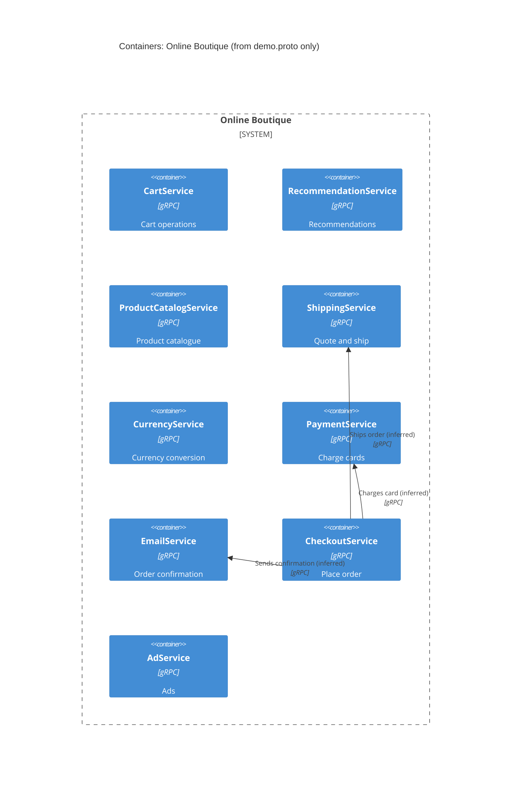

# Task 1, Run A: interfaces only

## 1. Agent
Claude Code, model claude-sonnet-5-5.

## 2. Files read
- `system/online-boutique/protos/demo.proto` (the only evidence allowed)

## 3. Containers table
The `.proto` defines gRPC services only. It does not show how they are packaged, so each gRPC `service` is treated as one container.

| Container | Technology | Responsibility | Evidence |
|---|---|---|---|
| CartService | gRPC (language not evidenced) | Add item, get cart, empty cart | `demo.proto` `service CartService` |
| RecommendationService | gRPC | List recommended products | `demo.proto` `service RecommendationService` |
| ProductCatalogService | gRPC | List, get and search products | `demo.proto` `service ProductCatalogService` |
| ShippingService | gRPC | Shipping quote and ship order | `demo.proto` `service ShippingService` |
| CurrencyService | gRPC | List currencies, convert money | `demo.proto` `service CurrencyService` |
| PaymentService | gRPC | Charge a credit card | `demo.proto` `service PaymentService` |
| EmailService | gRPC | Send order confirmation | `demo.proto` `service EmailService` |
| CheckoutService | gRPC | Place an order | `demo.proto` `service CheckoutService` |
| AdService | gRPC | Return ads | `demo.proto` `service AdService` |

## 4. Dependencies table
A `.proto` file declares what a service offers, not who calls it. The only caller-to-callee links visible are those implied by message contents. All are **[Inferred]**.

| Caller → Callee | Protocol | Evidence |
|---|---|---|
| CheckoutService → EmailService **[Inferred]** | gRPC | `OrderResult` and `SendOrderConfirmationRequest` carry order data, and `PlaceOrderResponse` returns an `OrderResult` |
| CheckoutService → PaymentService **[Inferred]** | gRPC | `PlaceOrderRequest` carries `CreditCardInfo`, which `ChargeRequest` also uses |
| CheckoutService → ShippingService **[Inferred]** | gRPC | `PlaceOrderRequest` carries `Address`, which `ShipOrderRequest` also uses |

No other dependency can be shown from this file.

## 5. Diagram

## 6. Gaps
- **End user, frontend, load generator:** not evidenced. `demo.proto` has no HTTP or web service. A deployment file or `frontend` source would settle it.
- **Who calls whom:** not evidenced beyond the three inferred links. The Kubernetes manifests (environment variables) would settle it.
- **Data stores:** none visible, although `CartService` must keep state somewhere. A manifest or the cart source would show it.
- **Languages, ports, replicas, external systems:** not evidenced.
- **Health service:** `protos/grpc/health` exists in the folder listing but was not opened.
