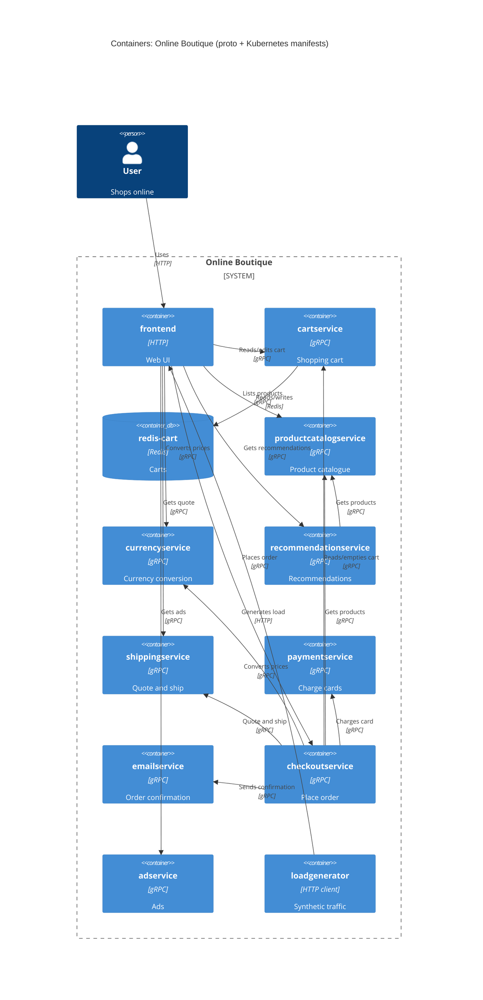

# Task 1, Run B: interfaces + deployment config

## 1. Agent
Claude Code, model claude-sonnet-5-5.

## 2. Files read
- `system/online-boutique/protos/demo.proto`
- `system/online-boutique/kubernetes-manifests/`: `adservice.yaml`, `cartservice.yaml`, `checkoutservice.yaml`, `currencyservice.yaml`, `emailservice.yaml`, `frontend.yaml`, `kustomization.yaml`, `loadgenerator.yaml`, `paymentservice.yaml`, `productcatalogservice.yaml`, `recommendationservice.yaml`, `shippingservice.yaml`, `README.md`

## 3. Containers table
| Container | Technology | Responsibility | Evidence |
|---|---|---|---|
| frontend | not evidenced; HTTP :8080, exposed on :80 | Web UI, entry point for users | `frontend.yaml` (Deployment, `frontend-external` LoadBalancer) |
| cartservice | gRPC :7070 (language not evidenced) | Shopping cart | `cartservice.yaml`, `demo.proto` `CartService` |
| redis-cart | Redis (`redis:alpine`), :6379 | Stores carts | `cartservice.yaml` (Deployment `redis-cart`, `REDIS_ADDR`) |
| productcatalogservice | gRPC :3550 | Product catalogue | `productcatalogservice.yaml` |
| currencyservice | gRPC :7000 | Currency conversion | `currencyservice.yaml` |
| recommendationservice | gRPC :8080 | Recommendations | `recommendationservice.yaml` |
| shippingservice | gRPC :50051 | Quote and ship order | `shippingservice.yaml` |
| paymentservice | gRPC :50051 | Charge cards | `paymentservice.yaml` |
| emailservice | gRPC, Service port 5000 (container `PORT` 8080) | Order confirmation | `emailservice.yaml` |
| checkoutservice | gRPC :5050 | Orchestrates order placement | `checkoutservice.yaml` |
| adservice | gRPC :9555 | Ads | `adservice.yaml` |
| loadgenerator | not evidenced | Generates traffic against the frontend | `loadgenerator.yaml` (`FRONTEND_ADDR`); commented out in `kustomization.yaml` |

## 4. Dependencies table
| Caller → Callee | Protocol | Evidence |
|---|---|---|
| User → frontend | HTTP | `frontend.yaml` (`frontend-external`, type LoadBalancer) |
| loadgenerator → frontend | HTTP | `loadgenerator.yaml` (`FRONTEND_ADDR=frontend:80`) |
| frontend → productcatalogservice | gRPC | `frontend.yaml` (`PRODUCT_CATALOG_SERVICE_ADDR`) |
| frontend → currencyservice | gRPC | `frontend.yaml` (`CURRENCY_SERVICE_ADDR`) |
| frontend → cartservice | gRPC | `frontend.yaml` (`CART_SERVICE_ADDR`) |
| frontend → recommendationservice | gRPC | `frontend.yaml` (`RECOMMENDATION_SERVICE_ADDR`) |
| frontend → shippingservice | gRPC | `frontend.yaml` (`SHIPPING_SERVICE_ADDR`) |
| frontend → checkoutservice | gRPC | `frontend.yaml` (`CHECKOUT_SERVICE_ADDR`) |
| frontend → adservice | gRPC | `frontend.yaml` (`AD_SERVICE_ADDR`) |
| checkoutservice → productcatalogservice | gRPC | `checkoutservice.yaml` (`PRODUCT_CATALOG_SERVICE_ADDR`) |
| checkoutservice → shippingservice | gRPC | `checkoutservice.yaml` (`SHIPPING_SERVICE_ADDR`) |
| checkoutservice → paymentservice | gRPC | `checkoutservice.yaml` (`PAYMENT_SERVICE_ADDR`) |
| checkoutservice → emailservice | gRPC | `checkoutservice.yaml` (`EMAIL_SERVICE_ADDR`) |
| checkoutservice → currencyservice | gRPC | `checkoutservice.yaml` (`CURRENCY_SERVICE_ADDR`) |
| checkoutservice → cartservice | gRPC | `checkoutservice.yaml` (`CART_SERVICE_ADDR`) |
| recommendationservice → productcatalogservice | gRPC | `recommendationservice.yaml` (`PRODUCT_CATALOG_SERVICE_ADDR`) |
| cartservice → redis-cart | Redis (TCP) | `cartservice.yaml` (`REDIS_ADDR=redis-cart:6379`) |

## 5. Diagram

## 6. Gaps
- **Languages and frameworks:** not evidenced. Dockerfiles or `src/` would settle it.
- **`frontend.yaml` also lists `SHOPPING_ASSISTANT_SERVICE_ADDR` (`shoppingassistantservice:80`),** but there is no manifest for that service and it is not in `kustomization.yaml`. Not added to the diagram. The `shoppingassistantservice` source or the optional component would settle it.
- **Commented-out options** in `kustomization.yaml` (memorystore, alloydb, spanner, shopping-assistant): not active, so not drawn.
- **Which RPCs each caller uses:** the manifests show addresses only, not methods. `src/*/main.go` would settle it.
- **External systems:** none evidenced.
- **Telemetry:** nothing in the manifests. `src/` may show more.
